# Using the Editor

This page covers the editor itself: its panels, what each one is for and
how to use it. For how a graph is made of nodes, attributes and code, see
[Graphs and Nodes](graphs.md); for how layers stack and pull each other in,
see [Layers and References](composition.md).

Checkout our example graphs
[here](https://github.com/nxt-dev/nxt_editor/tree/release/examples), and the
workflow and transition map [here](workflows.md).

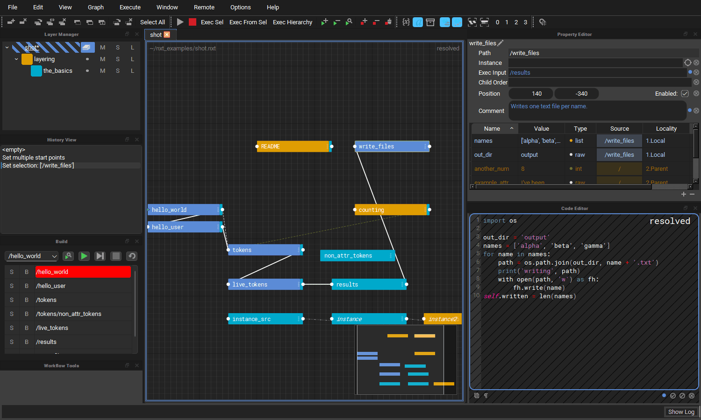

The editor is made of a graph (the stage view) in the middle, surrounded by
dock widgets that can be moved, tabbed and closed: the Layer Manager,
Property Editor, Code Editor, History View, Build View, Workflow Tools,
Output Log and [Hotkey Editor](hotkeys.md). Closed docks come back from the
**Window** menu.

## Docks and layout

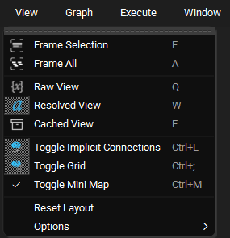

- **Float a dock** by dragging its title bar or tab out of the window, or,
  where several docks share a space as tabs, by double clicking its tab.
- **Dock it again** by dragging it back over the window until a space opens
  for it, or by double clicking its title bar, which returns it to where it
  was docked last.
- **View > Reset Layout** puts every dock back where a fresh install has
  it, with its default size. It resets to the editor's own layout, not to
  the one you left at the end of your last session. The layout you leave the
  editor in is still remembered for next time.
- The [Outliner](#outliner) and the [Instance View](#instance-view) are off
  until you turn them on from the **Window** menu.

## Stage View

The stage view draws the composited graph for the open tab. Each tab is
composited and drawn the first time it is selected, and kept from then on,
so switching back to a tab is instant.

**Window > Stage View** hides the graph, leaving the space to the docks,
and shows it again. The editor remembers your choice. With the graph
hidden, switch between open files from the bottom of the **Window** menu.

### How nodes look

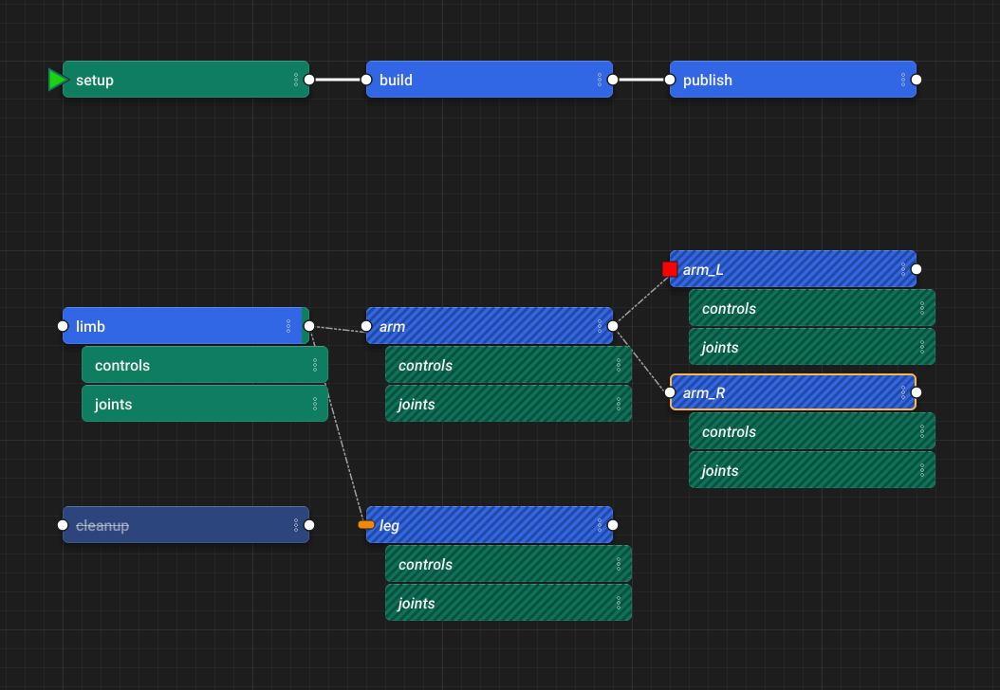

The editor is drawn in neutral dark greys, so the only color on screen is
your layers'. It ships its own fonts, sized in pixels, and its own colors,
so it looks the same on Windows, macOS and Linux, and inside Maya, Unreal
and Blender.

- A node is a rounded card. Its title bar is the color of the layer with
  the strongest opinion on it, and each weaker layer with an opinion adds a
  chip of its color at the right end. How layer colors are shown can be
  changed for you alone, see [Layer Color View](#layer-color-view)
  below.
- Names are white. A disabled node's title is faded and struck through, and
  a node that is an instance, or was made by one, has its name in italics
  and diagonal stripes across its title.
- A selected node has an amber outline, and the node under the mouse a thin
  white one.
- Start, skip and break points sit on the node's exec input: a green
  triangle, an orange bar and a red square.

### Layer Color View

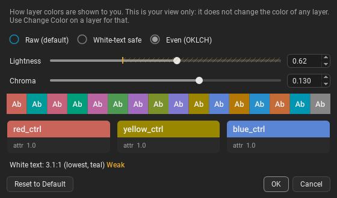

**View > Options > Layer Color View...** sets how layer and backdrop colors
are shown to you. It is a view preference, yours alone and remembered with
your preferences. It never changes the color a layer or backdrop is given:
that is chosen with **Change Color**, and is the same whatever anyone's
view, so a teammate sees the same file in their own view.

- **Raw (default)** shows every color exactly as it is.
- **White-text safe** shows a color too light for the white names on it
  darker, only as far as it takes for them to read at 4.5:1, keeping its
  hue.
- **Even (OKLCH)** shows every color at one lightness and chroma, keeping
  its hue, so no layer stands out from another. Set them with the sliders.
  Hues the screen can not show that colorful get as close as it can, and a
  grey stays grey.
- Example colors and three sample nodes show the view as you set it, with
  how well white text reads on the color it reads worst on: green when it reads
  at 4.5:1, amber when weaker, red below 3:1. A tick on the lightness
  slider marks where white text stops reading at 4.5:1 on every hue.
- While you drag a slider only the dialog follows it, and the editor is
  redrawn when you let go, or just after a typed value. **OK** keeps it,
  **Cancel** puts back the view you had, and **Reset to Default** goes back
  to raw.
- **In your view** in **Change Color** shows how the color you are choosing
  will look to you in this view.

### Running nodes

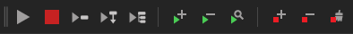

Besides **Execute Graph** (the play button) and stop, the toolbar has a
button for each way of running part of the graph. Hover a button to see
what it runs.

- **Execute Selected** (`Enter`), the play button with a node: runs only
  the selected nodes.
- **Execute From Selected**, the play button with a node and an arrow down:
  runs the selected node, then on down its exec chain.
- **Execute Hierarchy**, the play button with a parent and its children:
  runs the selected node and every node under it.

### Find Node

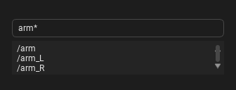

Press `/` over the graph to find nodes. Type any part of a node's name, and
the nodes that match are listed once you stop typing, ignoring case.

- `*` stands for anything: `arm*ctrl` finds `arm_L_ctrl` and `arm_R_ctrl`.
- Commas separate names: `arm, leg` finds either.
- A name with a `/` in it matches the whole path: `rig/*ctrl` finds the
  controls under `rig`.
- Nothing else is special. Dots, brackets and the like are matched as they
  are typed.

Pick a node in the list to select and frame it, or press `Enter` to select
and frame every node that matches. The Outliner's search box works the same
way.

### Mini map

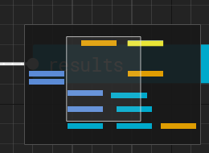

The mini map in the bottom right corner shows the whole graph, the selected
nodes, and a rectangle for the part of the graph the view is showing.

- Click anywhere in the mini map to centre the view there, or drag in it to
  pan.
- Toggle it with **View > Toggle Mini Map** or `Ctrl+M`. The choice is
  remembered between sessions.

### Backdrops

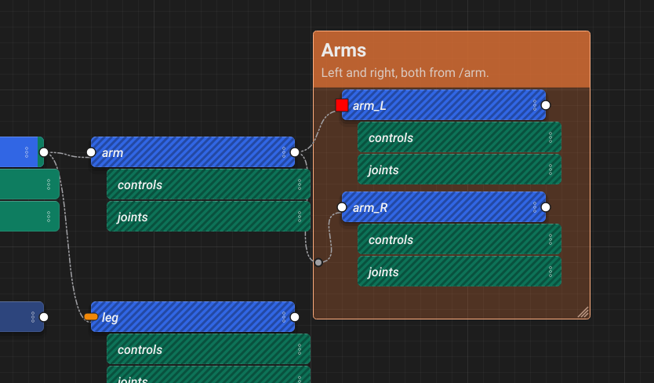

A backdrop is a colored box with a title and a note, drawn behind a group of
nodes to label what that part of the graph does. It only changes how the
graph looks: it is not a node and it never runs.

- **Add one** with `C` or **Add Backdrop** in the right click menu. With
  nodes selected the backdrop is drawn around them, otherwise an empty one
  is added under the mouse.
- **Move it** by dragging its header, the title and note at the top. Every
  node inside it, and every backdrop wholly inside it, moves with it, and
  the whole move is one undo. Hold `Ctrl` while dragging to move the
  backdrop on its own. Hold `Shift`, or turn on grid snapping, to snap to
  the grid.
- **Put nodes in it or take them out** by dragging the nodes. A node
  belongs to a backdrop when its middle is inside it, so nothing has to be
  kept up to date when nodes are renamed, deleted or pasted.
- **Resize it** by dragging the bottom right corner.
- **Edit the title, note and color** by double clicking the header, or
  with **Edit Backdrop...** in its right click menu. The note is shown under
  the title at the top left, wrapped to the backdrop's width, and grows the
  header to fit. The right click menu also has a **Color** submenu, **Select
  Nodes Inside** and **Fit to Nodes Inside**. Backdrops take the same
  colors as layers: any color, shown in your Layer Color View.
- **Delete it** with `Del` while it is selected, or **Delete Backdrop** in
  its right click menu. The nodes inside it stay where they are.

Only the header and the resize corner take the mouse, so you can still
start a rubber band selection inside a backdrop.

Backdrops are saved in the top layer's meta data, next to the node
positions. Backdrops from referenced layers are shown too. Changing one
saves the change on the top layer and leaves the referenced layer as it
was.

### Lines between nodes

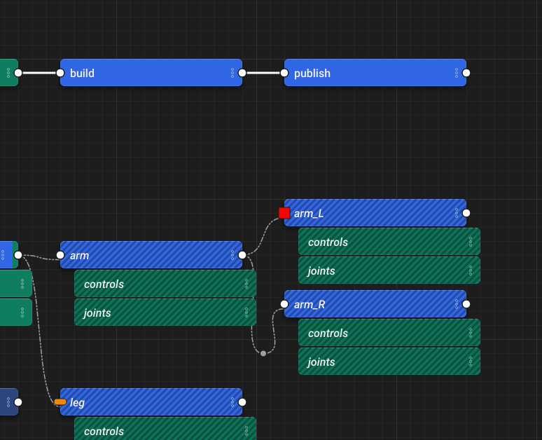

- **Straight or curved**: **View > Curved Connections** draws the graph's
  lines as curves that leave and meet each plug going across. The choice
  is saved with the graph, so everyone who opens it sees the same lines.
  It is also remembered in your preferences, and a graph that has not
  saved a choice of its own is drawn the way you last picked. With no
  preference, lines are straight.
- **Route a line through points**: double click a line to add a point
  there, then drag the point to bend the line around other nodes. A line
  can have as many points as you like, and the line passes through them in
  order. Hold `Shift`, or turn on grid snapping, to snap a point to the
  grid.
- **Remove a point** by double clicking it, or select it and press `Del`.
  `Shift` click adds points to or takes them out of the selection.
- **Select points with a box**: dragging a selection box picks up the
  points inside it along with the nodes, with the same keys as nodes
  (`Ctrl+Shift` adds, `Shift` toggles, `Ctrl` takes away). `Del` then
  removes the points and nodes together, as one undo.
- **Break a connection** by right clicking its line, a point on it, or a
  plug, and picking **Break Connection**. On a plug it breaks every line
  on that plug. What the line came from is taken out and nothing is left
  in its place: an exec input or instance is cleared, and an attribute is
  left empty, keeping any other text it held around the reference. A
  connection made on a weaker layer is broken by making that layer the
  target first. Lines into a node's code come from its code, and are
  changed in the code editor.

Points are the same size on screen at any zoom, so they can still be told
apart from their line when you zoom out.

Points stay where you put them when nodes move. Like backdrops, they are
saved in the top layer's meta data, and points from referenced layers are
shown too. A line's points belong to that one connection, so if the
connection is removed and made again its points come back.

### Animate Nodes

Nodes no longer slide open when a parent is expanded. Every child is
animated separately, so a node with hundreds of children opens noticeably
slower that way. The **Animate Nodes** action turns the animation back on.
It is listed under **Graph** in the [Hotkey Editor](hotkeys.md#graph),
where you can give it a shortcut, and the choice is remembered between
sessions.

### Deleting and pasting nodes

`Del` removes the selected node from the target layer. If no other layer has
an opinion on the deleted node's path, its descendants are removed with it,
so nothing is left behind as an implied "ghost" node. If another layer does
provide the node, the node from that layer shows through, as you would
expect from [layering](composition.md#layers). `Shift+Del` deletes the node and all of its
descendants.

Pasting nodes (`Ctrl+V`) is a single step on the undo stack however many
nodes are pasted.

## Code Editor

The code editor shows the compute of the selected node. It is read only
until you **double click** into it. Accept your edit with `Ctrl+Enter`, the
numpad `Enter`, or by clicking off the code, and cancel it with `Esc`.

The shortcuts below only apply while the code editor has focus, so for
example `Ctrl+D` expands the selection in the code editor but duplicates the
selected node in the graph. While the code editor, or one of its find
fields, has focus the main window's shortcuts are suspended so typing cannot
trigger them. All of these can be rebound in the
[Hotkey Editor](hotkeys.md#code-editor), and most are also on the code
editor's right click menu, with the line commands under **Line**.

| Action | Shortcut | Notes |
| :----- | :------: | :---- |
| Find In Code | `Ctrl+F` | Opens the find panel, filled in with the selected text |
| Replace In Code | `Ctrl+H` | Opens the find panel with the replace row showing |
| Find Next / Find Previous | `F3` / `Shift+F3` | Wraps around at either end |
| Go To Line | `Ctrl+G` | |
| Duplicate Line | `Ctrl+Shift+D` | Copies the selected line(s) below |
| Move Line Up / Down | `Alt+Up` / `Alt+Down` | |
| Delete Line | `Ctrl+Shift+K` | |
| Expand Selection | `Ctrl+D` | The word under the cursor, then the line, then everything |
| Complete Word | `Ctrl+Space` | See [Completion](#completion) |
| Go to a token's node | `Ctrl+click` | See [Following tokens](#following-tokens) |
| Indent / Un-Indent Line | `Tab` / `Shift+Tab` | Works on several lines at once |
| Comment Line | `Ctrl+/` | |
| Execute Selection Locally | `Shift+Return` | |
| Execute Selection Globally | `Ctrl+Shift+Return` | |
| Copy Resolved Code | `Ctrl+Shift+C` | |

!!! note "Two kinds of find"
    `Ctrl+F` in the code editor searches the compute you are looking at.
    `Ctrl+F` anywhere else opens the graph wide **Find and Replace**, which
    searches node attributes across the whole stage.

### Find and replace

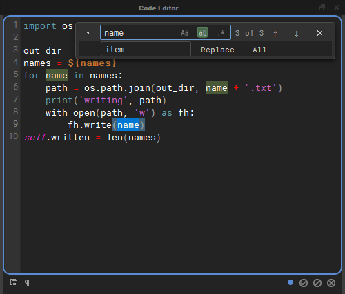

The find panel floats over the top right corner of the code, so the code
never moves when it opens.

- Type in the **Find** field and every match is highlighted, with the
  current match in a stronger colour. The counter shows which match you are
  on (`3 of 3`), or `bad pattern` when a regular expression is not valid.
- `Enter` and `Shift+Enter` in the field, `F3` and `Shift+F3`, or the arrow
  buttons step through the matches.
- The three toggles inside the field are **regular expression** (`.*`),
  **whole word** (`ab`) and **match case** (`Aa`).
- The chevron on the left shows the replace row. **Replace** replaces the
  current match and moves on to the next one; **All** replaces every match
  in one undoable step. Replacing needs the editor to be in editing mode;
  while it is read only the panel says *double click to edit*.
- `Esc` closes the panel.

### Go to line

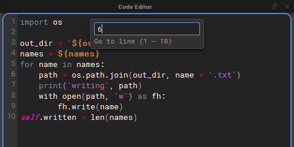

`Ctrl+G` drops a small field from the top of the editor. The view scrolls to
the line as you type, `Enter` goes there, and `Esc` puts the cursor back
where it was before you started.

### Highlighting

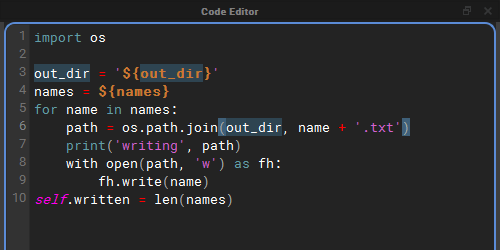

Every use of the word under the cursor is highlighted, and so is the bracket
next to the cursor together with its partner. A bracket without a partner is
drawn in a warning colour.

Syntax colouring applies to every match on a line, so a line with several
tokens or strings has all of them coloured, not only the first.

### Auto-pairing

While you edit, brackets and quotes come in pairs:

- Typing `(`, `[`, `{`, `"` or `'` adds the closing character after the
  cursor, so typing `${` gives `${}` with the cursor inside.
- Typing a closing character that is already right after the cursor steps
  over it rather than adding a second one, so typing the closer yourself
  out of habit does no harm.
- With text selected, typing an opening bracket or a quote wraps the
  selection in the pair, and the text stays selected.
- A quote typed straight after a letter or digit, or before one, is just
  typed, so apostrophes and string prefixes such as `f'` work as usual.
  Typing `"""` gives exactly three quotes.
- Keyboard layouts that type `[` and `{` with `AltGr` pair them too.
- Accepting a token completion inside `${}` does not leave a spare `}`
  behind.

### Following tokens

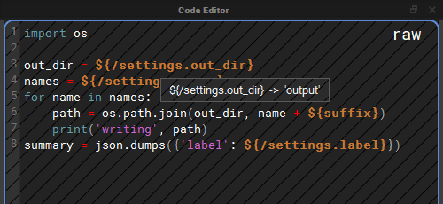

In Raw View (`Q`), where the code shows its `${}` tokens, the tokens can be
inspected and followed:

- **Hover** a token that reads an attribute, such as `${/settings.out_dir}`
  or a local `${suffix}`, to see the value it resolves to in a tooltip. If
  the token names a node that does not exist, the tooltip says so instead.
  `${file::}`, `${contents::}`, `${path::}` and tokens added by plugins are
  never resolved by hovering, because resolving them reads files or runs
  plugin code.
- **`Ctrl+click`** a token that reads an attribute of another node to select
  that node in the graph and frame it. While `Ctrl` is held, the mouse
  pointer turns into a pointing hand over a token you can follow. A token
  that reads the node's own attribute stays where it is, and a token naming
  a node that does not exist logs a warning.

`Ctrl+click` does nothing while you are editing the code, so it can never
take you to another node, and accept your edit on the way, by accident.

### Completion

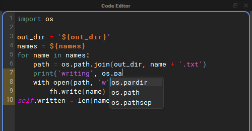

`Ctrl+Space` offers completions for the word in front of the cursor. Use the
arrow keys to choose one and `Enter` or `Tab` to insert it; `Esc` closes the
list. With **Code Editor Autocomplete** on, the list also appears by itself
once you have typed two characters of a word.

Completions come from six sources:

| Source | What it offers |
| :----- | :------------- |
| Python Builtins | Python's keywords and builtins, such as `return` and `enumerate`. |
| Imported Modules | Names inside the modules this compute imports, and inside the modules the world node (`/`) imports, since every compute can use those: `os.pa` offers `os.path`, and `os.path.jo` offers `os.path.join`. Aliases such as `import numpy as np` are understood. Only modules named on import lines are looked at, and a module that fails to import is skipped. |
| Node Attributes And Tokens | The node's attributes written as `name`, `self.name` and `${name}`; the names nxt gives every compute, `STAGE`, `self`, `w`, `execute`, `nxt_path`, `ExitNode`, `ExitGraph` and `types` (`nxt_path.` looks inside it); the token prefixes nxt knows about, including any added by plugins: `${file::`, `${filelist::`, `${path::` and so on; and [node paths](#node-paths-and-their-attributes) inside `${/`. |
| Words In This Compute | Words already written in the compute, which catches your own variable names. |
| Host Modules | The modules the host application already has loaded, under the names scripts usually give them, so they complete before any import line is written: `cmds`, `mc`, `mel`, `om`, `oma`, `omui`, `omr` and `pm` in Maya, `unreal` in Unreal, `bpy` in Blender, `pyfbsdk` in MotionBuilder and `pymxs` in 3ds Max. Only modules the host has already loaded are offered; nothing is imported for them. In the standalone editor there are none. |
| Python Analysis (jedi) | Optional. Uses [jedi](https://github.com/davidhalter/jedi) to work out what a name is, so that after a dot it can complete what a call returns or what a variable holds. See [Python analysis with jedi](#python-analysis-with-jedi). |

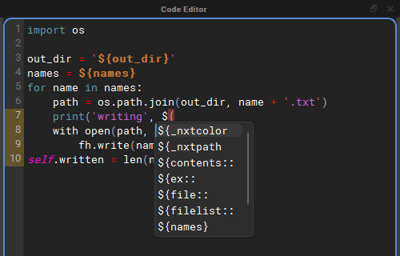

#### Node paths and their attributes

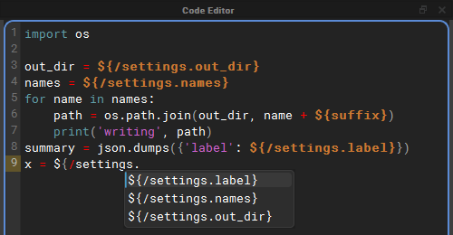

Inside a token that starts with `${/`, completion offers the paths of the
nodes in the graph (`${/settings`, `${/export/report`). Once a node path is
followed by a dot, it offers that node's attributes as whole tokens, so
choosing one writes `${/settings.out_dir}` complete with its closing brace.

#### Python analysis with jedi

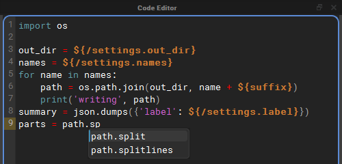

The other sources read names: they can complete `os.path.jo` because `os`
is imported, but not what `os.path.join(...)` returns. jedi analyses the
code, so after `path = os.path.join(out_dir, name)` it knows `path` is a
string and offers `path.split` and `path.splitlines`.

- It is optional. Install it with `pip install nxt-editor[completion]` (see
  [Standalone Installation](install.md#standalone-installation)). Without
  it, **Python Analysis (jedi)** is greyed out in the menu, and its
  description says how to install it.
- It is only asked after a dot. Bare names still come from the other
  sources, so switching one of those off keeps its names out of the list.
- It is asked once typing pauses, or straight away with `Ctrl+Space`. The
  answer is kept while you type more of the same name.
- It sees the world node's imports and the names nxt gives every compute.
  `${}` tokens are read as plain strings, so a compute full of tokens can
  still be analysed.
- jedi is loaded the first time it is needed, not when the editor starts,
  and keeps its cache in the nxt user directory.

#### Autocomplete options

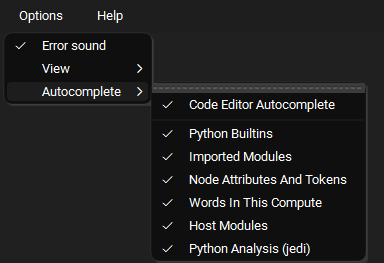

**Options > Autocomplete** holds the completion switches. They are all on by
default and remembered between sessions, and a change applies straight away,
even to a list that is already open.

- **Code Editor Autocomplete**: offer completions while you type. When it is
  off, completions only appear when you press `Ctrl+Space`.
- **Python Builtins**, **Imported Modules**, **Node Attributes And Tokens**,
  **Words In This Compute**, **Host Modules** and **Python Analysis (jedi)**:
  the sources described above.

## Layer Manager

The Layer Manager lists the layers of the open graph: the top layer and,
nested under it, the layers it references. Right click a layer for its
menu.

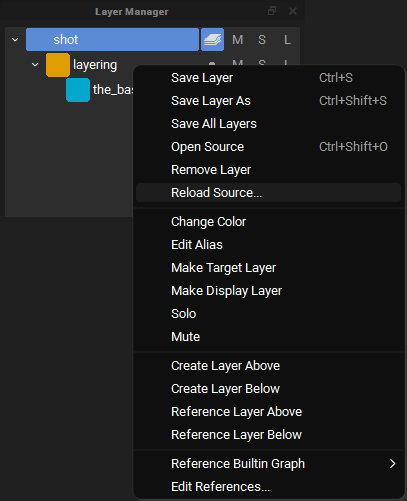

Two items on this menu change what a layer pulls in from disk:
**Edit References...** and **Reload Source...**.

### Reference Editor

**Edit References...** opens the Reference Editor on that layer.

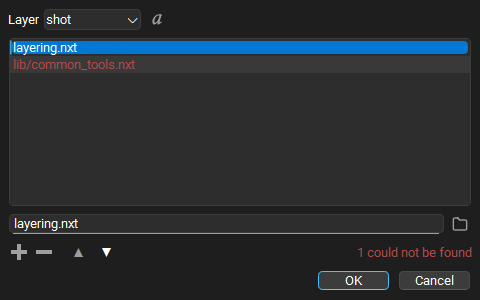

- **Layer** picks which layer's references you are editing. Only layers that
  are open in this graph and not locked can be edited.
- **The list** holds that layer's references in stack order: a reference
  higher in the list is stronger than the ones below it. Drag a row, or use
  the up and down arrow buttons, to change the order.
- **The field under the list** edits the selected reference. What you type
  is stored exactly as written, so a path with an environment variable in
  it, a path relative to the layer, or a path under one of your
  [file roots](composition.md#how-references-are-found) keeps working on other machines.
  The folder button next to the field picks a file with a file browser
  instead. A picked file that sits next to the layer, or in a folder below
  it, is stored relative to the layer; anything else is stored as a full
  path. A relative path is looked for under your file roots before the
  layer's folder, so check the resolved view if a root might hold a file of
  the same name.
- **+** adds an empty row and puts the cursor in the field, ready to type.
  An empty row that is never filled in is dropped. **-** removes the
  selected reference.
- **The resolved toggle** next to the layer picker switches every row
  between the path as stored and where it resolves to on this machine.
  Resolved paths are only for looking: they cannot be edited, so this
  machine's answer is never written into the layer.
- **Missing references** are drawn in red and counted
  (`1 could not be found`). They are kept exactly as written, in case they
  resolve on another machine. Hover over a row to see where nxt looked.

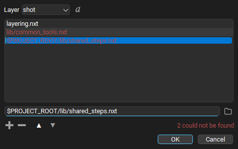

Pressing `Enter` in the field does not close the dialog. **OK** applies the
change to the open graph: the referenced layers are reloaded, the graph is
composited again, and the layer is marked unsaved. Nothing is written to
disk until you save the layer. Applying is one step on the undo stack, and
pressing **OK** with nothing changed does nothing at all.

### Reload Source

**Reload Source...** reads a layer from disk again, for example when
somebody else has saved a file your graph is built on. It is on every
layer's right click menu, and in the **File** menu next to **Save Layer**,
where it acts on the target layer.

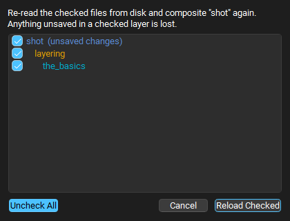

A layer is rarely just one file, so the dialog lists the layer and every
layer it references, as deep as they go, indented to show which layer
references which. Every row starts checked; uncheck the files you do not
want read again, or use the **Uncheck All** / **Check All** toggle. A file
referenced from several places is listed once. Rows with unsaved changes say
so, because reloading them throws those changes away.

**Reload Checked** reads the checked files again and composites the graph.
If a file now references something different, the layer stack follows it:
layers can appear, disappear or change order. Reloading is one step on the
undo stack, and undoing it puts back exactly what each layer held before,
without reading the files again.

### Show in Explorer

**Show in Explorer** opens the folder a layer is saved in, with the layer's
file selected. On a Mac it is called **Reveal in Finder** and opens the
Finder; on Linux it is **Show in File Manager**. It is on every layer's
right click menu, and in the **File** menu, where it acts on the target
layer. A layer that has never been saved has no file to show, so the item is
greyed out. If the file has been moved or deleted, the nearest folder that
still exists is opened instead.

## Build View

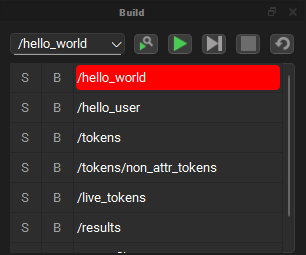

The Build View lists the nodes that will run, in execution order, from the
start point chosen in the drop down. Next to the drop down are buttons to
find the selected node, run the build, step through it, stop it and
restart it.

- **Find the selected node** (the magnifier) scrolls the build so the node
  selected in the graph is at the top of the list, and marks its row. A
  selected node is not always part of the build: it may be disabled,
  outside the start point's branch, or not executable at all. In that case
  the Output Log says the node is not in the build, and the editor dings.
- The node selected, here or anywhere else, has an amber edge, and the
  node under the mouse a white one. Only the node's name is outlined, not
  the break and skip boxes beside it, and the node that runs next stays
  red.
- The build stays current as you edit. Enabling or disabling a node,
  changing a start point, exec input, child order, instance path or parent,
  and renaming or deleting a node all update the list straight away.
- If the graph has changed since the last run in a way the cached runtime
  does not know about (a node was moved, renamed or deleted), the cache is
  cleared and rebuilt when the build is set up, before anything runs, and
  the Output Log says so.
- **Stop** ends the build once the node that is running finishes, whether
  the build was running or being stepped, and puts the start point and the
  build list back.

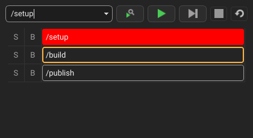

## Outliner

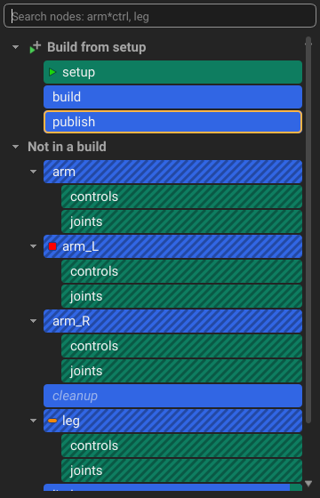

The Outliner lists the graph's nodes as a tree. It is off until you turn it
on from **Window > Outliner**.

- Root nodes are grouped by the build that runs them. Each start point
  has a **Build from** section listing the roots that run from it, in
  order, following exec connections. A root two builds reach is listed
  under the first. Everything no start point leads to is under **Not in a
  build**.
- Each node's children sit under it in their child order. Closed branches
  stay closed as you edit.
- A row is filled with the color of the layer with the strongest opinion
  on the node, and each weaker layer with an opinion adds a chip of its
  color at the right end, as on the node in the graph.
- The search box at the top finds nodes at any depth by their name, the
  same way as [Find Node](#find-node). Matching rows are bold, the nodes
  above them stay so you can see where they are, and `Enter` frames the
  first match.
- Text is white, as on the node in the graph, and a disabled node's is
  faded and in italics. An instanced node's row is striped, as its title
  is in the graph. Hovering a row outlines it in white and selecting
  it outlines it in amber, the row's color staying as it is.
- Start, break and skip points show before the name as they do on the
  node in the graph: the start icon, a red square for a breakpoint and an
  orange bar for a skip point.
- Selecting rows selects the nodes in the graph, and selecting nodes in the
  graph selects their rows.
- Rows work like their nodes in the graph. The node hotkeys work while
  the Outliner has focus (`D` to disable, `N` to add, `Del` to delete, `S`
  for a start point, `F` to frame and so on), and a right click gives the
  graph's node menu, with **Frame in Graph** at the top. Double click a
  row, or click its arrow, to collapse or expand its node, hold `Shift` to
  do the same to everything below it, and `Ctrl` double click, or `F2`, to rename it
  right there in the row.
- `Shift` click a group's arrow, or `Shift` double click its heading, to
  collapse every node in that build, or in **Not in a build**. When they
  all are, it expands them all. A plain click on the arrow only opens or
  closes the group.
- Right click below the rows for the graph's menu for empty space, to add
  or paste a node at the top of the hierarchy. It lands in the middle of
  the graph's view.
- Letters are hotkeys here, so typing does not jump between rows. Use the
  search box to find a node.

## Instance View

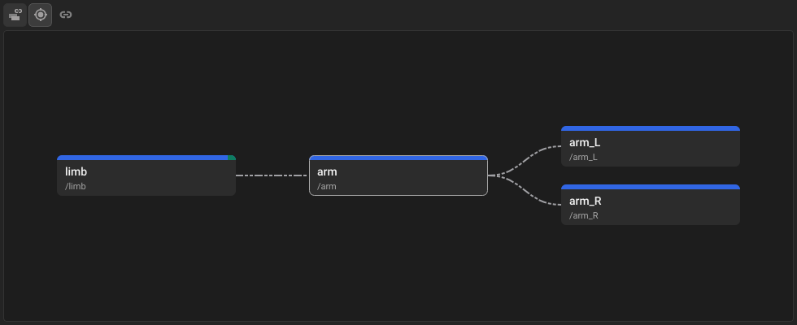

The Instance View shows a node's instance connections and nothing else.
Turn it on from **Window > Instance View**.

- It shows what the node instances from, back to the first source, on the
  left, and every node that instances it, and those that instance them, on
  the right, joined by the graph's instance lines. Nodes that only share a
  source with it are left out.
- Nodes are grey cards so they can be told from the graph at a glance. The
  layer colors are in a strip along the top: the strongest layer's across
  it, and a chip for each weaker one at its right end, as on the node in
  the graph. Each card shows the node's name and path, and the node shown
  has a light edge.
- **Follow Selection** shows whichever node is selected in the graph or the
  Outliner. With it off, select a node and press **Show Selected**. Double
  click a node in the view to show its connections instead.
- **Sync Selection** selects the nodes you pick in the Instance View in the
  graph and the Outliner too. Both toggles are remembered.
- Scroll to zoom, drag with the middle mouse button to pan, drag to box
  select, and press `F` to frame everything.

## AI Assistant

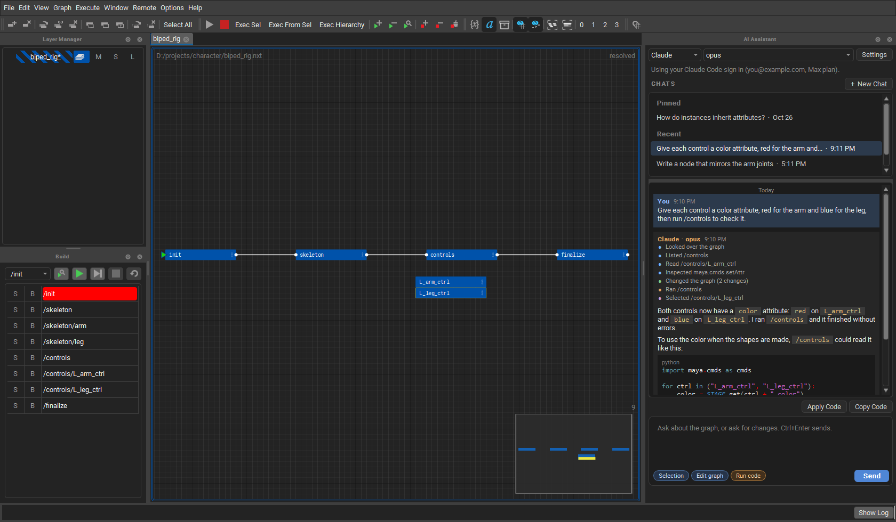

The AI Assistant is a panel for chatting with Claude, OpenAI, Grok or a local
model about the open graph. It can look over the graph, explain it, change it
and test its changes, and it shows each step it takes as it works.

It is off until it is turned on in **Options > AI Assistant**. Once it is on,
**Window > AI Assistant** opens the panel. Nothing is sent to a provider until
you ask it something.

### The parts of the panel

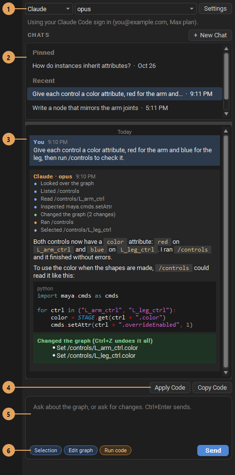

1. **Provider and model.** Who answers, and which of their models. The line
   under them says which sign in or key is being used. **Settings** opens
   **Options > AI Assistant**.
2. **Chats.** Every chat is kept, so **New Chat** does not lose the last
   one. Click a chat to go back to it and carry on. Right click a chat to
   **Pin** it to the top or **Delete** it. Pinned chats are listed first,
   then the rest, most recent first. Chats are saved in the editor's prefs
   folder, on this computer only.
3. **The conversation.** Your messages and the replies, each with the time
   it was sent, and the day wherever it changes. Each reply lists the steps
   it took, with a dot for each kind: blue for looking, purple for selecting
   nodes to show you, green for changing the graph, orange for running code,
   and a red cross for a step that could not be done. Changes it made are
   listed in a green box under the reply.
4. **Apply Code** and **Copy Code** show when a reply has a block of code.
   **Apply Code** puts it in the selected node, and undo puts the old code
   back. **Copy Code** copies it.
5. **The message box.** `Ctrl+Enter` sends. While a reply is coming,
   **Send** becomes **Stop**.
6. **What it may do.** These toggles are remembered:
    - **Selection** sends the selected nodes, their attributes and code with
      your message.
    - **Edit graph** lets it make, change and delete nodes, hierarchies,
      code, attributes and layers. All the changes in one reply are one undo
      step, so `Ctrl+Z` takes them back.
    - **Run code** lets it run nodes, builds and snippets of Python, in the
      editor or in the host such as Maya, to test its work and read what
      they print. It is off until you turn it on, and shows orange when on.

### Signing in

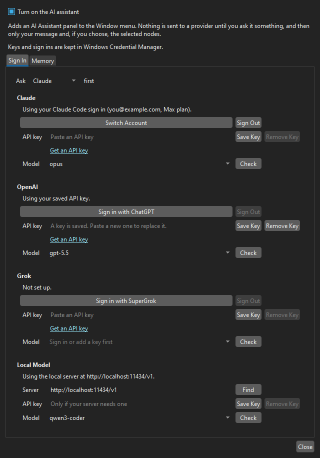

**Options > AI Assistant > Sign In** has a box for each provider:

- **Claude** uses the Claude Code app's sign in, so any Claude plan works
  and the editor never sees the account's token. **Sign in with Claude
  Code** (or **Switch Account**) runs Claude Code's own sign in in the
  browser. Claude Code needs to be installed for this.
- **OpenAI** can sign in with a ChatGPT plan, and **Grok** with SuperGrok.
- Each can use an **API key** instead, or the usual environment variable
  (`ANTHROPIC_API_KEY`, `OPENAI_API_KEY`, `XAI_API_KEY`).
- **Local Model** points at a server on this computer or the network:
  Ollama, LM Studio, llama.cpp, vLLM or Jan. **Find** looks for one that is
  running.

**Ask ... first** picks the provider the panel starts with, and **Check**
asks a provider for its models. Keys and sign ins are kept in the operating
system's secure store.

### How it works with the graph

The assistant uses tools to look at the graph rather than guessing: it can
look over the layers and nodes, list a hierarchy, read a node's attributes
and code, search, check the build order, find problems and read the Output
Log. With **Edit graph** on it can change the graph, and with **Run code** on
it can run what it changed and read the output.

With a Claude sign in, the tools are served to Claude Code by the editor's
own MCP server, which only listens on this computer and takes a new key for
every reply. The other providers use the same tools through their own tool
calling. A model that can not use tools answers without them, and changes
the graph with a block of changes the editor applies instead.

### Reading code and imports

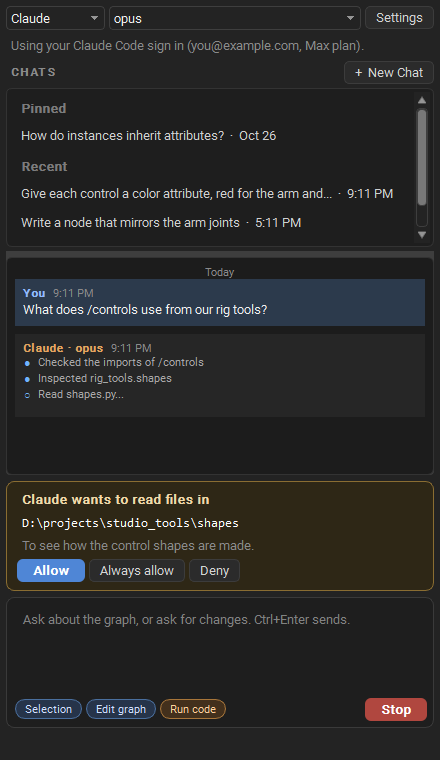

The assistant can read code on this computer. The open graph's folder is
free to read. Before it reads anywhere else it asks, with its reason:

- **Allow** lets it read that folder for the rest of the chat.
- **Always allow** lets it read the folder in every chat, and remembers it
  in **Memory** with what the folder holds, so later chats know to look
  there.
- **Deny** says no, and it does not ask again in that reply.

It can also inspect the modules a graph imports: where each one is found,
what functions and classes it has and their arguments, or one of them in
full. Modules are read as source, without being imported, so their code is
not run. A module that is already imported, such as `maya.cmds` in Maya, is
looked at as it is.

### Memory

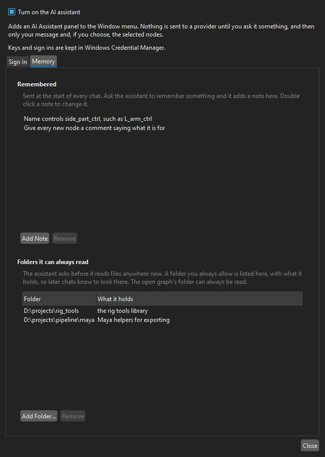

Ask the assistant to remember something, such as how you name controls, and
it saves a short note. Notes are sent at the start of every chat.
**Options > AI Assistant > Memory** lists them, and the folders it can
always read with what each one holds. Double click a note, or what a folder
holds, to change it; **Remove** takes it away, and **Add Note** and **Add
Folder...** add your own.

## Property Editor, History View, Output Log and Workflow Tools

See the [tutorial videos](tutorials.md) for a tour of these. The History
View lists every step on the undo stack, including reference edits and
reloads.

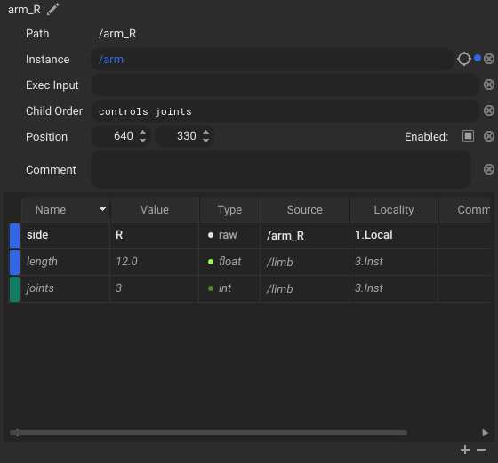

In the Property Editor's attribute table, each row is in the color of the
layer its value comes from, lighter where the selected node sets the value
itself and darker where it inherits it. Instanced values are in italics.

Darker layer colors can be hard to read as text, so **View > Options >
Neutral Property Text** shows the rows in neutral text instead: bright,
in bold across the row, where the node sets the value, and a softer grey where it
inherits it. The row header on the left is filled with the layer's color,
and stays in view however far you scroll the table. The source looks like a
button only under the mouse; click it to go to that node. It is off by
default and remembered with your preferences.
